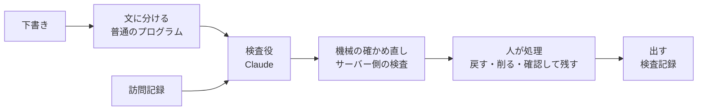

# もとがある報告書

訪問看護報告書の**下書きを、訪問記録と1文ずつ見比べて確かめる道具**です。下書きを作る道具ではありません。

公開URL：（公開後に追記）

> 架空のデータだけで作った見本です。本物の記録は入れないでください。

## 誰の、どんな困りごとか

訪問看護ステーションは、利用者1人ごとに訪問看護報告書を作り、主治医に定期的に出します。材料は1か月分の訪問記録です。

生成AIで下書きすると書く時間は短くなります。けれども、**下書きが記録と合っているかを確かめる手間**は減りません。見比べれば節約した時間が戻り、見比べなければ記録に無い文（例：「夜間は良眠」）や、AIが足した説明語が主治医に届いてしまいます。

この道具は、下書きの文ごとに「記録のどこがもとか」を示し、もとが見当たらない文に印を付けます。職員は印の付いた文だけを確かめればよくなります。

## 見本モードの使い方（ログイン不要）

1. 入口の画面で、架空の見本（5組）から1つ選びます。
2. 照合の画面で、左の訪問記録と右の文ごとの判定を見比べます。黄（言い換え）と赤（根拠なし・反する）の文ごとに「記録の言葉に戻す」「削る」「確認して残す」から選びます。「確認して残す」には理由を書きます。
3. 赤の文がすべて処理されると「出す」を押せます。検査記録が出るので、ブラウザの印刷で紙に出せます。

見本モードはAIを呼びません。前もってAIに判定させて保存しておいた結果を表示します。

### 判定の4段階

| 判定 | 意味 | 色 |
|---|---|---|
| 一致 | 記録に同じ内容がある | なし |
| 言い換え | 記録の内容を別の言葉にした・まとめた | 黄 |
| 根拠なし | 記録のどこにも見当たらない（記録に無い評価や説明語を足した文も含む） | 赤 |
| 反する | 記録と食い違う | 赤＋二重線 |

「根拠なし」は誤りという意味ではなく、**確認が要るという印**です。

## 実行モード

架空の訪問記録と下書きを貼って、AIに照合させます。

- 入力は合わせて4,000字まで
- 全体で1日30回まで（日本時間で日付が変わると戻ります）、同じ接続元からは1分に3回まで。上限に達しても見本モードは使えます
- 氏名・電話番号・住所・生年月日のように見える箇所があると、送信しません（画面とサーバーの両方で確かめます）

## この道具がしないこと

- 診断や治療の助言はしません
- 本物の記録は使いません。架空のデータだけで作っています
- 入力した内容は保存しません。画面を閉じると消えます
- 判定は内容の正しさを証明するものではありません。検査記録の冒頭にも「これは内容の正しさの証明ではなく、確認の記録です」と書きます

## 仕組み



1. **文に分ける**：句点と改行で切って番号を付けます。AIに任せないのは、文を飛ばされないためです。
2. **検査役**：訪問記録と番号つきの文だけをAIに渡し、文ごとに判定・根拠の記録番号・記録からの引用・理由を決まった形で返させます。
3. **機械の確かめ直し**：AIの答えをそのまま信じません。返ってこなかった文は「根拠なし（未判定）」にし、引用が記録に一字一句そのまま無ければ「根拠なし」に下げ、理由に言い切りの語があれば伏せます。
4. **人が処理**：黄と赤の文ごとに、人が処理を選びます。赤が1つでも残っていると「出す」は押せません。
5. **出す**：作成者・確認者・日時・判定ごとの件数・文ごとの処理と理由・処理後の本文を、印刷用の検査記録にします。

## 検証の結果

架空の5組（38文）で、人が付けた正解と比べました。詳しくは [docs/kensho-kiroku.md](docs/kensho-kiroku.md) にあります。

| 項目 | 結果 |
|---|---|
| 見本モードで表示している判定と正解の一致 | 36/38文 |
| 根拠なしの見逃し（正解が赤なのにAIが一致・言い換えとした数） | 0 |
| 揺れの測定（同じ5組を4回ずつ、計20回） | 赤かどうかが回によって入れ替わった文 0、見逃し 0、4回とも同じ判定だった文 35/38 |

正解は開発中にAIが付け、依頼者がルールに照らして2件を見直しました。正解の付け方と見直しの理由も記録に残しています。

## 使ったもの

- Next.js（App Router）
- Cloudflare Workers（@opennextjs/cloudflare）、Workers の Rate Limiting、Workers KV（回数の上限）
- Claude API（検査役のモデル：claude-opus-5-5）、zod（AIの答えの形の確かめ）

このリポジトリのコードと文書は、Claude Code を開発の中心に据えて作りました。

## 手元での起動

Node.js が入っている前提です。

```bash
npm install
npm run dev
```

http://localhost:3000 を開きます。見本モードはこれだけで使えます。

実行モードを手元で試す時だけ、リポジトリ直下に `.dev.vars` を作り、自分で発行した Claude API のキーを `ANTHROPIC_API_KEY=` の形で1行書きます（このファイルはコミットしない設定です）。手元では回数の上限は掛かりません。

### 確かめるためのコマンド

| コマンド | 内容 |
|---|---|
| `npm run typecheck` | 型検査 |
| `npm run check:fixtures` | 架空の5組の形と、正解の引用が記録に一字一句あるか |
| `npm run check:review` | 文ごとの処理と「出す」のガード |
| `npm run check:limits` | 回数の上限（31回目で止まる、失敗は数えない、日付で戻る、1分の上限） |
| `npm run judge:fixtures` | 見本の判定をAIで作り直して保存（キーが要る。費用がかかる） |
| `npm run eval` | 判定の揺れを測る（キーが要る。費用がかかる） |
