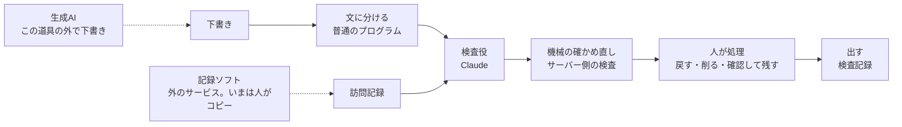

# URADORI（ウラドリ＝裏取り）

訪問看護報告書の**下書きを、訪問記録と1文ずつ見比べて確かめる道具**です。下書きを作る道具ではありません。

公開URL：（公開後に追記）

> 架空のデータだけで作った見本です。本物の記録は入れないでください。

**公開版では、見本の文だけ照合できます。** 操作は本番と同じ「貼る→照合する→赤を直す→出す→本文をコピー」で、違うのは、判定が「同じ文に対して前もって Claude が付けて保存した物」であることだけです（公開版ではAIを呼びません。結果の先頭にもそう書きます）。文を変えてその場でAIに照合させる形は、手元で動かした様子を動画で見られます。このリポジトリを手元で動かし、自分の Claude API の鍵を入れても使えます（下の「手元での起動」）。

## 審査員の方へ（3分の触り方）

- 公開URL：（公開後に追記）
- 動画：（収録後に追記）

1. 入口の「見本01を開いて試す（約3分）」を押す
2. ①訪問記録と②下書きの欄に入っている文（架空。記録ソフトからコピーして貼った想定）を見て、「③ 照合する」を押す
3. 赤い印の S04 で「記録の言葉に戻す」を選び、S06・S08 も処理する（S08 は引用が無いので「削る」か「確認して残す」。残す時は理由を書く）
4. 下の「出す」を押す（検査記録が出る。「印刷する」で印刷プレビュー）
5. 「本文をコピー」を押す（記録ソフトの報告書の欄に貼って出す想定）

欄の文を1字でも変えて「照合する」を押すと、公開版では「見本の文だけ照合できます」と出ます。「見本の文を入れ直す」で戻せます。

## 誰の、どんな困りごとか

訪問看護ステーションは、利用者1人ごとに訪問看護報告書を作り、主治医に定期的に出します。材料は1か月分の訪問記録です。

生成AIで下書きすると書く時間は短くなります。けれども、**下書きが記録と合っているかを確かめる手間**は減りません。見比べれば節約した時間が戻り、見比べなければ記録に無い文（例：「夜間は良眠」）や、AIが足した説明語が主治医に届いてしまいます。

この道具は、下書きの文ごとに「記録のどこがもとか」を示し、もとが見当たらない文に印を付けます。職員は印の付いた文だけを確かめればよくなります。

## 見本の使い方（公開版・ログイン不要）

1. 入口の画面で、架空の見本（5組）から1つ選びます。①訪問記録と②下書きの欄に、記録ソフトからコピーして貼った想定の架空の文が入っています（消して貼り直すことも、「見本の文を入れ直す」で戻すこともできます）。
2. 「照合する」を押すと、左に訪問記録、右に下書きの文ごとの判定が出ます。黄（言い換え）と赤（根拠なし・反する）の文ごとに「記録の言葉に戻す」「削る」「確認して残す」から選びます。「確認して残す」には理由を書きます。
3. 赤の文がすべて処理されると「出す」を押せます。検査記録が出るので、ブラウザの印刷で紙に出せます。直した本文は「本文をコピー」でコピーできます。

公開版はAIを呼びません。見本の文と同じ文で「照合する」を押した時だけ、同じ文に対して前もって Claude（claude-opus-5-5）が付けて保存した判定を返します。文が見本と違う時は照合しません。

### 判定の4段階

| 判定 | 意味 | 色 |
|---|---|---|
| 一致 | 記録に同じ内容がある | なし |
| 言い換え | 記録の内容を別の言葉にした・まとめた | 黄 |
| 根拠なし | 記録のどこにも見当たらない（記録に無い評価や説明語を足した文も含む） | 赤 |
| 反する | 記録と食い違う | 赤＋二重線 |

「根拠なし」は誤りという意味ではなく、**確認が要るという印**です。

## 実行モード（公開版では止めています）

自分で書いた文を貼って、その場でAIに照合させます。公開版では止めており（照合できるのは見本の文だけ）、手元で動かした時だけ使えます。手元では、見本の文で押しても保存済みを返さず、AIを呼びます。

止めている理由：誰でも文を貼れる形は、実際の記録が入る可能性があります。実データが入りうる物を、認証なしで公開しないためです（あわせてAI代の心配もなくなります）。

開けた時の決まり：

- 入力は合わせて4,000字まで
- 全体で1日30回まで（日本時間で日付が変わると戻ります）、同じ接続元からは1分に3回まで。上限に達しても見本モードは使えます
- 1日30回は全体の上限です。1人が使い切った日は、ほかの人も実行モードを使えません（見本モードは使えます）
- AIに届いた後の失敗（時間切れ・答えの途中切れなど）も、AI代が掛かるので1回と数えます。AIに届く前に断った時は数えません
- 送る前に、氏名・電話・住所などの形を見つけたら送信を止めます（画面とサーバーの両方）。これは形で見分ける目印で、全部は止められません
  - 止められるのは、敬称つきの氏名（とローマ字の氏名）・電話・メール・郵便番号・住所・生年月日の形だけです。敬称の無い氏名・保険番号・利用者ID・事業所名は止められません
- 照合のため、入力は Anthropic社のAPIへ送ります
  - 送るのは、決まった指示文と、訪問記録（記録番号・日付・職種・本文）と、番号を付けた下書きの文だけです。作成者・確認者の名前や、選んだ処理は送りません（どちらも画面の中だけで使います）

## この道具がしないこと

- 診断や治療の助言はしません
- 本物の記録は使いません。架空のデータだけで作っています
- この道具は入力を保存しません。画面を閉じると消えます（実行モードでは、照合のため Anthropic社のAPIへ送ります）
- 判定は内容の正しさを証明するものではありません。検査記録の冒頭にも「これは内容の正しさの証明ではなく、確認の記録です」と書きます

## 記録ソフトとのつなぎ方（いまと、この先）

- **いま**：訪問記録は、現場では記録ソフト（訪問看護で使われている記録サービス。例：カイポケ、iBow）にあり、この版では人がコピーして貼る形だけを作っています。記録ソフトとの連携（API・CSV取り込み・ブラウザ拡張）は作っていません
- **確かめたこと**：各社の公開APIは、2026-11-05 時点で公開情報を見つけられませんでした（見つからない＝無い、ではありません）
- **作り**：`/api/judge` の入力の形（記録の一覧と下書きの文字列）は貼り付けに依存しないので、別の入口を足せる形です。ただし本物の記録を扱うには、利用者を限った入口（認証）・氏名などを消す仕組み・上限（合計4,000字）の見直しが別に要り、どれも作っていません。ブラウザ拡張は、今の「自サイト以外からの送信を断る」守りを変える設計が要ります
- **手間の見積もり**（架空の事業所の前提）：1人分1回の貼り付けを30秒とすると、20人分で月10分

## 仕組み



凡例：点線＝この道具の外。「出す」で出るのは検査記録です。報告書そのものは、記録ソフト側や紙で別に主治医へ出します。

1. **文に分ける**：句点と改行で切って番号を付けます。AIに任せないのは、文を飛ばされないためです。
2. **検査役**：訪問記録と番号つきの文だけをAIに渡し、文ごとに判定・根拠の記録番号・記録からの引用・理由を決まった形で返させます。
3. **機械の確かめ直し**：AIの答えをそのまま信じないための、万一の時の備えです。返ってこなかった文は「根拠なし（未判定）」にし、引用が記録に一字一句そのまま無い・短すぎる・文とほとんど重ならない時は「根拠なし」に下げ、理由に言い切りの語やURLがあれば伏せます。既存5組だけの測定（11/4まで）では一度も判定を直しませんでしたが、見ていない45組を足した11/5の測定では、AIが根拠の引用を空で返した13件を根拠なしに下げました（150回中）。わざと壊した答え（記録に無い引用、紛れ込ませた指示の行、文の欠け）で発火することは `npm run check:postcheck` で確かめています。
   - 記録と下書きの中に書かれた指示には従わないよう、AIへの指示に書いています。区切りの書き込みは無害にしてから渡します。画面のAIの理由には「AIの説明（参考）」と見出しを付けています。
4. **人が処理**：黄と赤の文ごとに、人が処理を選びます。赤が1つでも残っていると「出す」は押せません。
5. **出す**：作成者・確認者・日時・判定ごとの件数・文ごとの処理と理由・処理後の本文を、印刷用の検査記録にします。

## 検証の結果

架空の5組（38文、うち正解が赤の文は17文）で、正解と比べました。詳しくは [docs/kensho-kiroku.md](docs/kensho-kiroku.md) にあります。

主な主張は「赤（根拠なし・反する）か、赤でないか」の区別です。指示2版×4回の計8回の測定を、見直し後の正解で数え直しました。

規模の小さい測定です（架空5組・38文・赤17文）。主張は『赤か赤でないか』の区別だけで、4段階の細かい一致は幅で書きます。

| 項目 | 結果 |
|---|---|
| 赤か赤でないかの一致（8回分） | 304/304 |
| 赤の見逃し（正解が赤なのにAIが一致・言い換え） | 0/136（赤17文×8回） |
| 4段階の一致 | 34〜37/38（測定の幅） |
| 見本モードで表示している判定 | 4段階 36/38、赤か赤でないか 38/38 |

**見ていない45組を足した測定（2026-11-05）**：指示を作る時に一度も見ていない架空の45組（363文、赤177文）を新しく作り、正解を先にコミットしてから、既存5組と合わせて50組×3回（150回、$4.71）通しました。見ていない45組で、赤の見逃しは 0/531、赤か赤でないかの一致は 1062/1089（97.5%）。赤でない側の取り違え（言い換え→根拠なし）が24件あり、うち12件はAIが根拠の引用を空で返したためにサーバー側の検査が下げたもの、残り12件は結果を見た後に正解の作り方の誤りとして直した文の分です（直した後は 1077/1089）。

読む時の注意：

- 赤の文は17文しかないので、見逃し0でも、見逃しの割合が小さいとまでは言えません
- 正解は開発に使ったClaudeが付け、看護の専門職は確認していません
- AIへの指示の調整と上の表の測定には同じ5組を使いました。見ていない45組（fixtures-holdout/）も、正解は開発に使ったClaudeが作り、結果を見た後に5文を直しています（5文ともAIの答えの側。見逃し0は直す前でも同じ）
- 「反する」と「根拠なし」の境目のルールは、AIの判定と正解の食い違いを見た後に書き、そのルールで正解を2件直しました（2件ともAIの答えの側に動きました）

## 使ったもの

- Next.js（App Router）
- Cloudflare Workers（@opennextjs/cloudflare）、Workers の Rate Limiting、Workers KV（回数の上限）
- Claude API（検査役のモデル：claude-opus-5-5）、zod（AIの答えの形の確かめ）

このリポジトリのコードと文書は、Claude Code を開発の中心に据えて作りました。

## Claudeの使い方（審査向け）

詳しくは [docs/claude-no-tsukaikata.md](docs/claude-no-tsukaikata.md) にあります。

- 作る係（コードと文書を書く会話）と、確かめる係（報告を受けてブラウザで通す会話）を、別の会話に分けました
- 公開の前に、進め方の点検役・セキュリティの点検役・Codex の3つに確認させ、指摘を直しました
- Claude Code の Skills・サブエージェント・MCP・フックは、このリポジトリには作っていません（コミット前の鍵の形の検査は git の pre-commit で、Claude Code のフックではありません）

## 手元での起動

Node.js が入っている前提です。

```bash
npm install
npm run dev
```

http://localhost:3000 を開きます。見本の文の照合は、これだけで（鍵が無くても）保存済みの判定で試せます。鍵を入れると、見本の文でもその場でAIを呼びます。

手元版も架空データ専用です。本物の記録を扱える設計（認証・氏名などを消す仕組み・契約の確認）はしていません。

実行モードを手元で試す時だけ、リポジトリ直下に `.dev.vars` を作り、自分で発行した Claude API のキーを `ANTHROPIC_API_KEY=` の形で1行書きます（このファイルはコミットしない設定です）。手元の `npm run dev` では、実行モードは既定で開いており、回数の上限は掛かりません。

## 公開の手順（見本だけの公開版）

公開版には Claude API の鍵を入れません。実行モードのスイッチ（`wrangler.jsonc` の `vars` の `RUN_MODE`）は `"closed"` のままにします。

```bash
npx wrangler login
npm run deploy
```

閉じている間、`/api/judge` は本文を読まず、回数の仕組みにも触れず、AIも呼ばずに503を返します。

### 実行モードを開け直す手順（公開版で開ける場合）

順番を守ります。途中で開けると、AIを呼ばずに503で止まります（鍵が無い時・1日の回数を持つ KV が無い時）。

1. 1日の回数を持つ KV を作る：`npx wrangler kv namespace create JUDGE_COUNTS`。表示された id を控える
2. `wrangler.jsonc` に `"kv_namespaces": [{ "binding": "JUDGE_COUNTS", "id": "<控えた id>" }]` を足す。あわせて、`ratelimits` の `namespace_id`（いまは `1001`）が同じアカウントの中でほかと重ならないことを確かめる
3. 鍵を入れる：`npx wrangler secret put ANTHROPIC_API_KEY`（聞かれたら鍵を貼る。鍵はファイルやチャットに書かない）
4. スイッチを開く：`wrangler.jsonc` の `"RUN_MODE"` を `"open"` にして、`npm run deploy`
5. Console の月の支出上限を確かめる（最後の止め）

### 確かめるためのコマンド

| コマンド | 内容 |
|---|---|
| `npm run typecheck` | 型検査 |
| `npm run check:fixtures` | 架空の5組の形と、正解の引用が記録に一字一句あるか |
| `npm run check:holdout` | 見ていない45組（試験用、画面には出さない）の形と、正解の引用・個人情報の形・入力の上限 |
| `npm run check:review` | 文ごとの処理と「出す」のガード |
| `npm run check:limits` | 回数の上限とAI代の守り（31回目で止まる、AIに届いた後の失敗は数える・届く前は数えない、日付で戻る、1分の上限、本番で仕組みが欠けたら止める、入力の上限、よそのサイトからの送信） |
| `npm run check:postcheck` | 機械の確かめ直しと、記録・下書きに紛れ込ませた指示への備え（見本の判定が変わらないことも確かめる） |
| `npm run judge:fixtures` | 見本の判定をAIで作り直して保存（キーが要る。費用がかかる） |
| `npm run eval` | 判定の揺れを測る（キーが要る。費用がかかる）。`-- --dirs fixtures,fixtures-holdout --rounds 3 --limit 8` で読むフォルダ・回数・費用の上限を変える。`-- --rescore <記録>` はAIを呼ばずに数え直す |
